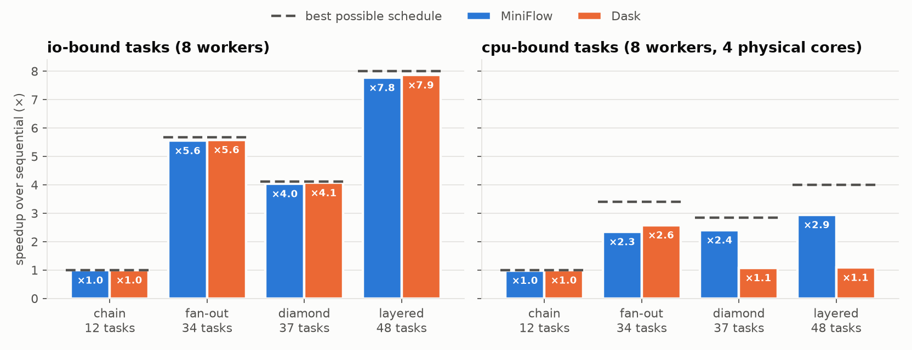
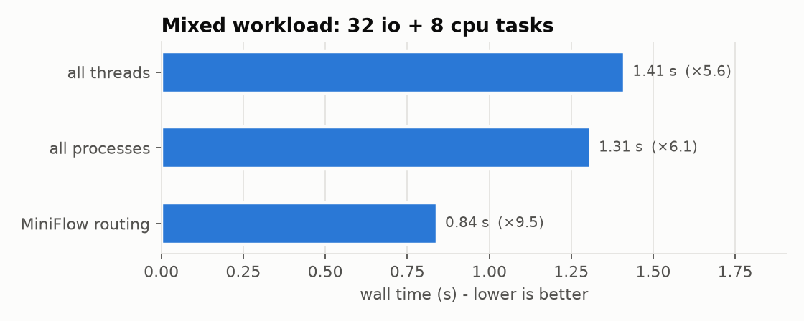
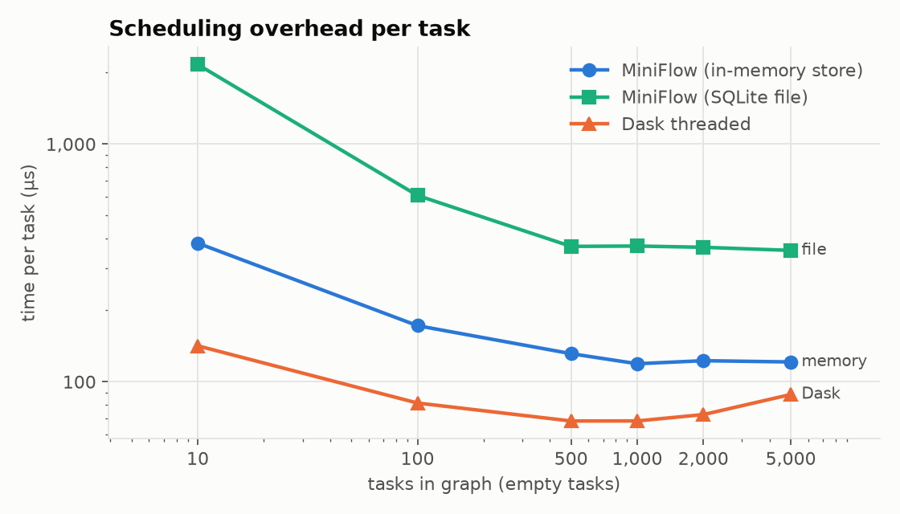
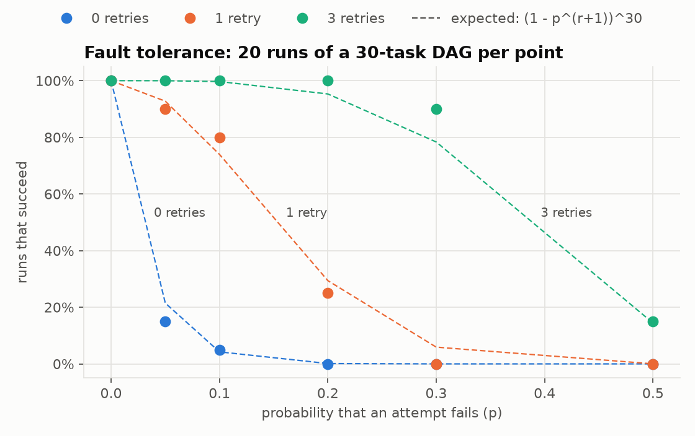
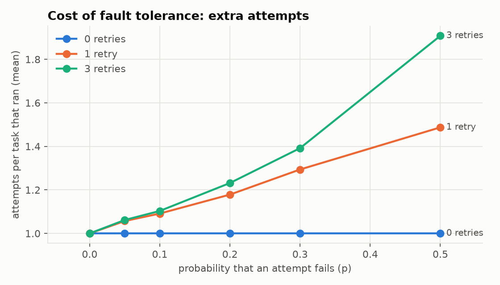
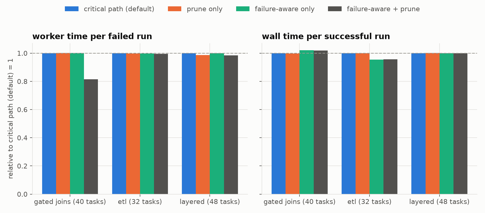

# MiniFlow evaluation results

Generated by `python -m benchmarks.run` on 2026-10-07 22:36 · Python 3.13.6 · Windows-11-10.0.26200-SP0 · 8 logical CPUs (4 physical cores) · 8 workers · median of 3 runs · Dask 2026.8.0.

## 1. Speedup over sequential execution

Every task costs the same. *Level bound*: speedup of the best level-by-level schedule, where each dependency level needs ceil(size / P) waves (the optimum for chain, fan-out and diamond). *Work/span*: min(P, tasks / depth), a looser upper bound. *Amdahl*: treats depth / tasks as the serial fraction. Note that cpu-bound pure-Python tasks are limited by physical cores, not logical CPUs.

| kind | shape | tasks | depth | sequential (s) | MiniFlow (s) | MiniFlow × | Dask × | level bound × | work/span × | Amdahl × |
|---|---|---|---|---|---|---|---|---|---|---|
| io | chain | 12 | 12 | 0.606 | 0.611 | 0.992 | 0.996 | 1 | 1 | 1 |
| io | fan-out | 34 | 3 | 1.72 | 0.309 | 5.55 | 5.58 | 5.67 | 8 | 4.95 |
| io | diamond | 37 | 9 | 1.87 | 0.463 | 4.03 | 4.07 | 4.11 | 4.11 | 2.96 |
| io | layered | 48 | 6 | 2.42 | 0.312 | 7.77 | 7.86 | 8 | 8 | 4.27 |
| cpu | chain | 12 | 12 | 0.631 | 0.641 | 0.984 | 0.993 | 1 | 1 | 1 |
| cpu | fan-out | 34 | 3 | 1.78 | 0.761 | 2.35 | 2.58 | 3.4 | 8 | 4.95 |
| cpu | diamond | 37 | 9 | 2.11 | 0.877 | 2.4 | 1.08 | 2.85 | 4.11 | 2.96 |
| cpu | layered | 48 | 6 | 2.63 | 0.894 | 2.94 | 1.09 | 4 | 8 | 4.27 |

## 2. Choosing the worker per task

| configuration | wall time (s) | speedup × |
|---|---|---|
| all threads | 1.41 | 5.63 |
| all processes | 1.31 | 6.07 |
| MiniFlow routing | 0.841 | 9.45 |

## 3. Scheduler overhead

Empty tasks in random layered graphs; time per task in microseconds.

| tasks | direct call | MiniFlow (memory) | MiniFlow (SQLite file) | Dask threaded |
|---|---|---|---|---|
| 10 | 0.34 | 383 | 2,161 | 142 |
| 100 | 0.103 | 172 | 608 | 81.4 |
| 500 | 0.076 | 131 | 371 | 68.3 |
| 1000 | 0.0688 | 119 | 372 | 68.4 |
| 2000 | 0.0607 | 123 | 368 | 72.7 |
| 5000 | 0.0567 | 121 | 357 | 88.4 |

## 4. Fault tolerance

Each attempt of every task fails with probability p. A run succeeds only if all 30 tasks do, so the expected rate is (1 - p^(r+1))^30 for r retries.

| retries | p | runs succeeded | expected | tasks succeeded | attempts / task run | wall (s) |
|---|---|---|---|---|---|---|
| 0 | 0 | 1 | 1 | 1 | 1 | 0.017 |
| 0 | 0.05 | 0.15 | 0.215 | 0.785 | 1 | 0.018 |
| 0 | 0.1 | 0.05 | 0.0424 | 0.625 | 1 | 0.0146 |
| 0 | 0.2 | 0 | 0.00124 | 0.395 | 1 | 0.0129 |
| 0 | 0.3 | 0 | 2.25e-05 | 0.26 | 1 | 0.0108 |
| 0 | 0.5 | 0 | 9.31e-10 | 0.147 | 1 | 0.00825 |
| 1 | 0 | 1 | 1 | 1 | 1 | 0.0174 |
| 1 | 0.05 | 0.9 | 0.928 | 0.988 | 1.06 | 0.0238 |
| 1 | 0.1 | 0.8 | 0.74 | 0.937 | 1.09 | 0.0251 |
| 1 | 0.2 | 0.25 | 0.294 | 0.8 | 1.18 | 0.0285 |
| 1 | 0.3 | 0 | 0.0591 | 0.573 | 1.29 | 0.0307 |
| 1 | 0.5 | 0 | 0.000179 | 0.332 | 1.49 | 0.026 |
| 3 | 0 | 1 | 1 | 1 | 1 | 0.0162 |
| 3 | 0.05 | 1 | 1 | 1 | 1.06 | 0.0247 |
| 3 | 0.1 | 1 | 0.997 | 1 | 1.1 | 0.029 |
| 3 | 0.2 | 1 | 0.953 | 1 | 1.23 | 0.0418 |
| 3 | 0.3 | 0.9 | 0.783 | 0.99 | 1.39 | 0.0552 |
| 3 | 0.5 | 0.15 | 0.144 | 0.732 | 1.91 | 0.078 |

## 6. Failure-aware priority and pruning

Run separately with `python -m benchmarks.run --only e6` on 2026-10-29 · Python 3.13 · Linux, 2 logical CPUs · 4 io workers · 40 fault seeds per policy, 8 training runs · 480 runs checked for correctness, 0 violations. Tasks sleep (io), so the core count doesn't limit them.

Cheap, flaky steps (35 % of attempts fail, one retry) sit among reliable, more expensive ones. *failure-aware* starts a ready step early when its learned failure risk times the work its failure would make useless exceeds the delay it causes; *prune* skips waiting steps whose results can no longer reach any sink. History comes from separate training runs; faults are deterministic per seed, so every policy sees the same failed runs. *Useless work*: worker time on steps whose results nothing in the run could use. Ratios are against the default.

| workload | policy | runs succeeded | worker s / failed run | × | useless worker s | first failure (s) | failed run wall (s) | successful run wall (s) | × |
|---|---|---|---|---|---|---|---|---|---|
| gated joins (40 tasks) | critical path (default) | 0.6 | 1.45 | 1 | 0.279 | 0.319 | 0.377 | 0.395 | 1 |
| gated joins (40 tasks) | prune only | 0.6 | 1.45 | 1 | 0.279 | 0.32 | 0.377 | 0.395 | 0.998 |
| gated joins (40 tasks) | failure-aware only | 0.6 | 1.45 | 1 | 0.279 | 0.0241 | 0.376 | 0.403 | 1.02 |
| gated joins (40 tasks) | failure-aware + prune | 0.6 | 1.18 | 0.814 | 0.00914 | 0.024 | 0.307 | 0.403 | 1.02 |
| etl (32 tasks) | critical path (default) | 0.45 | 1.03 | 1 | 0.13 | 0.217 | 0.278 | 0.303 | 1 |
| etl (32 tasks) | prune only | 0.45 | 1.02 | 0.996 | 0.129 | 0.216 | 0.276 | 0.303 | 0.999 |
| etl (32 tasks) | failure-aware only | 0.45 | 1.02 | 0.997 | 0.13 | 0.207 | 0.276 | 0.289 | 0.955 |
| etl (32 tasks) | failure-aware + prune | 0.45 | 1.02 | 0.994 | 0.128 | 0.206 | 0.275 | 0.29 | 0.956 |
| layered (48 tasks) | critical path (default) | 0.525 | 1.67 | 1 | 0.0614 | 0.341 | 0.441 | 0.474 | 1 |
| layered (48 tasks) | prune only | 0.525 | 1.64 | 0.987 | 0.0399 | 0.337 | 0.435 | 0.475 | 1 |
| layered (48 tasks) | failure-aware only | 0.525 | 1.67 | 1 | 0.0614 | 0.337 | 0.435 | 0.474 | 0.999 |
| layered (48 tasks) | failure-aware + prune | 0.525 | 1.64 | 0.985 | 0.0381 | 0.337 | 0.428 | 0.475 | 1 |

What this shows:

- **The two parts only pay off together.** On gated joins (a cheap precondition beside
  expensive independent steps, all needed by one report), *prune only* saves nothing
  because by the time the precondition fails the doomed work has already run, and
  *failure-aware only* finds the failure 13× sooner (0.024 s vs 0.32 s) but still runs
  the doomed work. Together they cut worker time per failed run by 19 %, useless work by
  97 % and failed-run wall time by 19 %.
- **Cost on successful runs is small:** +2 % wall time on gated joins, where cheap
  precondition steps are moved ahead of expensive ones.
- **Gains depend on the graph.** In the ETL pipeline the flaky checks can only start
  after their transforms, and each check feeds several reports, so there is little to
  save (under 1 %). Its successful runs got 4–5 % faster, which comes from ranking with
  learned durations rather than from failure awareness. In random layered graphs the
  saving is 1–2 %.
- Pruning moves work rather than deleting it when a run is later resumed: a pruned
  step runs during the resume. It is saved for good when the run is abandoned or fixed
  upstream of that step.

## 7. Failure and resume: reuse-aware salvage

Run separately with `python -m benchmarks.run --only e7` on 2026-10-29 · same machine as section 6 · 4 io workers · 40 fault seeds per policy (16 failed runs each), 8 training runs per regime · 288 runs checked, 0 violations.

The gated-join workload, counting a failed run plus what follows it. *Resumed*: failures are transient and every failed run is resumed after the fix. *Abandoned*: failed runs are never resumed. Each regime's policies learn from training runs of that regime. *salvage* keeps doomed steps whose results were usually reused after a failure, running them after the live work, and prunes the rest.

| regime | policy | doomed steps run | failed run worker s | failed run wall (s) | resume wall (s) | total worker s | × | total wall (s) |
|---|---|---|---|---|---|---|---|---|
| resumed | critical path (default) | 6.75 | 1.44 | 0.377 | 0.0544 | 1.5 | 1 | 0.431 |
| resumed | failure-aware + prune | 4.06 | 1.34 | 0.351 | 0.0843 | 1.5 | 1 | 0.436 |
| resumed | failure-aware + prune + salvage | 6.75 | 1.45 | 0.38 | 0.0547 | 1.5 | 1 | 0.435 |
| abandoned | critical path (default) | 6.75 | 1.45 | 0.377 | 0 | 1.45 | 1 | 0.377 |
| abandoned | failure-aware + prune | 4.06 | 1.34 | 0.351 | 0 | 1.34 | 0.931 | 0.351 |
| abandoned | failure-aware + prune + salvage | 4.06 | 1.35 | 0.354 | 0 | 1.35 | 0.932 | 0.354 |

What this shows:

- **No fixed policy wins both regimes.** Pruning saves 7 % worker time when failures are
  abandoned, but when they are resumed it only moves the doomed work into the resume:
  the resume takes 0.084 s instead of 0.054 s, a 55 % slower recovery after the fix.
- **Salvage matches the better fixed policy in each regime, without configuration.**
  With a resume history it keeps the doomed work (resume 0.055 s, like the default);
  with an abandoned history it prunes (−7 %, like pruning).
- **No net saving over a full failure + resume cycle:** the work is done once either
  way. The value is choosing, per step, whether to do it now or not at all.

## 8. Reusing LLM answers across daily runs

Run separately with `python -m benchmarks.run --only e8` on 2026-10-30 · Linux, 2 logical CPUs · 200 tickets, 15 days, 3 seeds per policy · simulated model (offline), so the numbers show the mechanism's behaviour, not a real model's.

A ticket-triage flow (summarise, then label the summary) runs daily on the offline simulated model while tickets arrive and change. *learned, downstream-verified* reuses a near match only in similarity bands where checks showed the label changes no more often than when the model is simply asked again (95 % upper bound). *self-verified* judges the summary step by its own text instead, as verified semantic caches do. Days 1 onward, averaged over seeds.

| workload | policy | model calls / day | × no reuse | near-match reuses / day | checks / day | wrong labels |
|---|---|---|---|---|---|---|
| small edits | no reuse | 400 | 1 | 0 | 0 | 0.0367 |
| small edits | exact | 99.7 | 0.249 | 0 | 0 | 0.0331 |
| small edits | fixed threshold 0.8 | 39.5 | 0.0988 | 49.2 | 0 | 0.116 |
| small edits | fixed threshold 0.95 | 61.4 | 0.153 | 29.8 | 0 | 0.0313 |
| small edits | learned, self-verified | 101 | 0.252 | 5.26 | 57.7 | 0.044 |
| small edits | learned, downstream-verified | 91.3 | 0.228 | 11.3 | 49.3 | 0.0315 |
| note edits | no reuse | 400 | 1 | 0 | 0 | 0.0289 |
| note edits | exact | 94.5 | 0.236 | 0 | 0 | 0.0331 |
| note edits | fixed threshold 0.8 | 37.2 | 0.0931 | 56 | 0 | 0.124 |
| note edits | fixed threshold 0.95 | 86.9 | 0.217 | 7.48 | 0 | 0.0317 |
| note edits | learned, self-verified | 85.7 | 0.214 | 14.7 | 47.9 | 0.0545 |
| note edits | learned, downstream-verified | 81.8 | 0.205 | 18.7 | 44 | 0.0502 |

What this shows:

- **Judging the summary by its downstream effect is what makes it reusable.** Judged by its
  own text (*self-verified*), a reworded summary always looks changed, so the summary step
  almost never reuses: 101 calls a day, no better than exact caching. Judged by whether the
  label changes, it reuses 2–4× as many near matches and needs 9–13 % fewer calls than
  exact caching, with as many wrong labels on small edits (3.2 % vs 3.3 %).
- **Fixed thresholds depend on the workload.** 0.8 reuses the most but gets 12 % of labels
  wrong in both workloads. 0.95 is the best policy on small edits (61 calls, 3.1 %) but
  saves little on note edits (87 calls), where harmless edits are less similar.
- **The learned policy pays for its checks.** About 45–50 checks a day, each a model call,
  keep it from matching the best fixed threshold on small edits. On note edits, where
  harmless and meaningful edits have the same similarity, its errors rise to 5.0 % (exact:
  3.3 %): a near-match answer that is wrong stays wrong until the ticket changes again.

## 5. Correctness

Every MiniFlow run above was checked against the state store: **440 runs, 63083 attempts, 0 violations.** No attempt started before all of its upstream tasks had finished, every SKIPPED task had a FAILED ancestor, and every FAILED task used exactly its retry budget.

